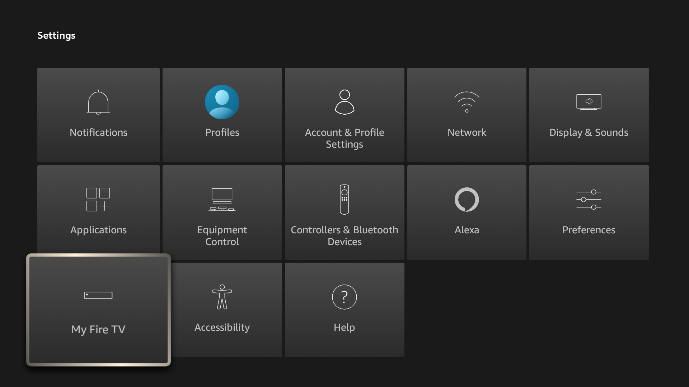
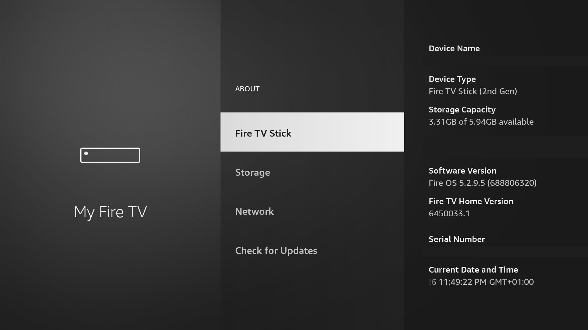

# GhostLock — one-shot root for the Fire TV Stick 2 (tank)

Build-guarded, re-playable, **one-shot** root for a stock Amazon Fire TV Stick
2nd gen (AFTT, codename `tank`) running Fire OS 5.2.9.5 build
`288.6.8.8_user_688806320` (kernel `3.10.54+`, ARM32, MT8127).

No recovery, no unlocked bootloader, no Magisk, no persistent modification: the
tool obtains a root shell for one command, and that is it. The exploit itself
only touches kernel memory; the PC side never writes outside
`/data/local/tmp`.

> **Research / authorized devices only.** The build guard is not decorative:
> the exploit uses fixed kernel addresses. Running it on another build means
> memory corruption. Read [Safety](#safety) first.

> **TL;DR — if you can open the stick, use amonet instead.** It is simpler and
> gives a real, persistent root. GhostLock only makes sense if you refuse to
> open the device. See [Should you use this?](#should-you-use-this-probably-not).

## Should you use this? Probably not

Let's be blunt: **if you are willing to open the Fire TV Stick, use amonet
instead.** The bootrom route (see `docs/GUIDE-AMONET-tank.md` and
`scripts/amonet_*`) gives you a real, persistent root — TWRP, Magisk, a normal
`su`, modules — and it survives reboots. It is also **simpler and more
reliable** overall than this exploit: no build-specific kernel offsets, no
one-shot session, no ~2 % chance of a panic per attempt.

This project exists for one narrow case: you **refuse to open the device** (no
case prying, no test point, no USB bootrom timing) and you only need one
privileged session over ADB — debloat, disable OTA, back up app data — on a
stick that is still on `288.6.8.8_user_688806320`.

If that is you, keep reading. Otherwise close this page and go flash amonet.

## Compatibility

| | |
|---|---|
| Device | Fire TV Stick 2nd gen — AFTT / `tank` |
| Build | `288.6.8.8_user_688806320` **only** |
| Kernel | `3.10.54+` (2025-04-27), ARM32, MT8127, no KASLR |
| Runs as | `shell` (uid 2000), like a stock device |
| Guard | refuses any other device / build / kernel |

An OTA removes the bug. If you want to keep the device exploitable, disable the
OTA packages first (`scripts/debloat_tank.py`).

## Screenshots

Captured on the reference unit (`288.6.8.8_user_688806320`).  Personal info redacted.

**Navigation flow — long-press HOME → Fire TV quick menu → Settings → About:**


| | |
|---|---|
|  |  |
| Projectivy running as default home (Amazon launcher disabled) | Fire TV Settings — accessible via long-press HOME or MENU → Android settings |



*About page: Fire OS 5.2.9.5 (build 688806320), Fire TV Stick (2nd Gen)*

---

## Quick start

Requirements: `adb`, USB debugging enabled on the stick, Python 3.9+.

```
adb devices
python scripts/gl_bench.py --serial <serial> doctor
python scripts/gl_root.py  --serial <serial> --cmd "id; getenforce"
```

Example output:

```
build:  288.6.8.8_user_688806320 (tank)
kernel: Linux version 3.10.54+ ...
attempt 1/3 ... ROOT (0.6s)
---- command output ----
uid=0(root) gid=0(root) ... context=u:r:kernel:s0

Permissive
------------------------
```

`--cmd` is one shell command line (chain with `;`). It runs in a root child of
the exploit process, its output is captured, and nothing stays behind.

## What it is good for

A one-shot maintenance shell on a stock device — the actions the `shell` user
cannot do:

- read/write other apps' private data (`/data/data/...`): backups, prefs
  patches, SQLite edits;
- `iptables` / netfilter (block OTA or telemetry at the network level);
- protected settings (`settings put secure/global`), restricted
  `dumpsys` / `am` / `pm` operations;
- persistent effects that live in `/data`: `pm disable-user`,
  `pm uninstall --user 0`, custom launcher, user APKs.

It is **not**: a permanent root, a `su`/Magisk replacement, a custom ROM, or a
way to modify `/system` (read-only, dm-verity, locked bootloader).

Note that many debloat actions (`pm disable-user`, `pm uninstall --user 0`)
already work over plain ADB. GhostLock adds the privileged layer on top.

## How it works (short version)

1. Three threads drive a PI-futex requeue race
   (`FUTEX_WAIT_REQUEUE_PI` / `FUTEX_CMP_REQUEUE_PI`). The `-EDEADLK` rollback
   removes A's `rt_mutex_waiter` from the target lock but leaves
   `A->pi_blocked_on` pointing at it.
2. A plants a fake `rt_mutex` / `plist` node over that stale waiter with
   `ioctl(ASHMEM_SET_NAME)`: the 256-byte `set_name()` stack buffer covers the
   waiter, and A then spins in userspace without any further syscall.
3. B takes the futex; the PI chain walk follows the fake node and
   `plist_del()` performs a controlled 4-byte write.
4. The write redirects one pointer — `ashmem_misc.fops` — to a fake
   `file_operations` table in our own page. B opens `/dev/ashmem`, and
   `misc_open()` calls `fake->open`.
5. The payload restores the pointer, neutralizes the fake fd
   (`file->f_op = def_chr_fops`), installs a fresh cred for the calling task
   (`uid 0`, full caps, kernel SID) and sets `selinux_enforcing = 0`.

Offsets, measurements and dead ends:
[`docs/PLAN-GHOSTLOCK-TANK.md`](docs/PLAN-GHOSTLOCK-TANK.md).

## Reliability

Per attempt: ~90–95 % on a warm system, ~80 % right after boot, ~2 % panic
(`panic_on_oops=1` → plain reboot, the exploit writes nothing to the eMMC).
`gl_root.py` retries up to `--attempts` (default 3), reboots cleanly between
attempts, and waits for the device to come back after a panic.

Measured on the reference unit:

| Campaign | Result |
|---|---|
| 40 in-process rounds | 40/40 first attempt |
| 27 CLI invocations, warm device | 27/27 first attempt |
| **20 cold boots**, full tool, ≤ 3 attempts | **20/20** (4 needed one retry) |

## Repository layout

```
probes/         trigger, stack/canary probes, final exploit (gl_exploit.c), mutex probe
scripts/        PC tooling: gl_bench.py (bench + crash black box), gl_root.py
                (one-shot root CLI), tank_serial.py (serial resolution),
                find_misc_fops.py, debloat/backup helpers
docs/           plan, offsets, measurements, guides
source-subset/  the few GPL kernel sources that matter (rtmutex.c, futex.c,
                tank_defconfig)
```

The legacy lab helpers (`debloat_tank.py`, `amonet_*`, …) no longer hardcode a
serial: they take `$TANK_SERIAL` (or auto-detect the only `tank` device), and
`$ADB` / `$FASTBOOT` override the binary paths.

## Getting the vendor assets

The repository does not ship Amazon's kernel image, the vendor source tree nor
run logs (see `.gitignore`). To regenerate them locally:

```bash
python scripts/fetch_boot.py
# firmware/boot-688806320.img, kernel-688806320.zimage, kernel-688806320.raw

pip install vmlinux-to-elf        # or: uv tool install vmlinux-to-elf
vmlinux-to-elf firmware/kernel-688806320.raw firmware/kernel-688806320.elf

python scripts/fetch_sources.py           # index page + tarball URL only
python scripts/fetch_sources.py --scan    # also stream and extract the sources
```

`fetch_boot.py` reads the public OTA with HTTP range requests, so it transfers a
few MB instead of the whole ~600 MB file; it decompresses the XZ kernel payload
and checks the `3.10.54+` banner. `vmlinux-to-elf` turns that raw kernel into an
analysable ELF (it also accepts the `.zimage` directly). The curated sources
that the offset work relies on are committed in `source-subset/`.

`find_misc_fops.py` parses the ELF program headers (no hardcoded layout), so it
works on a freshly rebuilt ELF too:

```bash
python scripts/find_misc_fops.py ashmem --kernel firmware/kernel-688806320.elf
```

## Safety

- The exploit never writes to the eMMC. A failure is a kernel panic → reboot.
- The build guard is mandatory: fixed addresses, wrong build = corruption.
- Use it only on devices you own, where this is legal.
- After a successful run SELinux stays permissive until the next reboot.
- A reboot after use is the clean thing: a failed attempt leaves stale
  PI-futex state behind, which is why the tool reboots before retrying.

## Python version

The scripts require **Python 3.7 or newer** (`from __future__ import annotations`
and `list[str] | None` union syntax). Python 3.6 — which is the system default on
some older Windows installations — will raise a `SyntaxError` on import.

```
python --version        # must be 3.7+
python gl_root.py --serial <serial> --cmd "id"
```

On Windows, if `python` resolves to 3.6, use the Microsoft Store build instead:

```
%LocalAppData%\Microsoft\WindowsApps\PythonSoftwareFoundation.Python.3.12_qbz5n2kfra8p0\python3.12.exe
```

or install Python 3.9+ from [python.org](https://python.org) and make it the
default.

---

## Known issues & fixes (build 688806320)

### 1 — `pm disable-user` does not stick when the package was explicitly enabled

**Symptom:** running `pm disable-user com.amazon.tv.launcher/.ui.HomeActivity_vNext`
returns `new state: enabled` and the Amazon launcher keeps claiming the home
screen after the next exploit run.

**Root cause:** a prior `pm enable com.amazon.tv.launcher` (needed to restore
Settings access) placed `HomeActivity_vNext` in `enabledComponents`
(state = `COMPONENT_ENABLED_STATE_ENABLED = 1`).  `disable-user` sets state 3
(`DISABLED_USER`), which does not override an explicit enable for system
packages in Android 5.1.

**Fix:** use `pm disable` (state 2, `DISABLED`) instead:

```bash
python scripts/gl_root.py --serial <serial> \
  --cmd "pm disable com.amazon.tv.launcher/.ui.HomeActivity_vNext"
```

Verify with:

```bash
adb shell "pm dump com.amazon.tv.launcher | grep -A3 disabledComponents"
# → com.amazon.tv.launcher.ui.HomeActivity_vNext
```

---

### 2 — Amazon launcher reclaims home after reboot even with HomeActivity_vNext disabled

**Symptom:** Projectivy is set as the launcher but after a reboot the Amazon
home appears again.

**Root cause:** `com.amazon.firehomestarter` is a separate package that can
restart the Amazon home independently of `HomeActivity_vNext`.

**Fix:** disable both in one exploit run:

```bash
python scripts/gl_root.py --serial <serial> \
  --cmd "pm disable com.amazon.tv.launcher/.ui.HomeActivity_vNext; \
         pm disable-user com.amazon.firehomestarter"
```

---

### 3 — Settings button on the remote stops working after disabling the launcher package

**Symptom:** the Fire TV remote's Settings button does nothing after running
`pm disable com.amazon.tv.launcher` or `pm disable-user com.amazon.tv.launcher`.

**Root cause:** the Settings button routes through
`com.amazon.tv.launcher/.ui.MainSettingsActivity`.  If the whole package is
disabled, that activity is unreachable.

**Fix:** keep the **package** enabled; only disable the specific home activity
component (see issue 1).  The correct state is:

| Component | State |
|---|---|
| `com.amazon.tv.launcher` (package) | **enabled** |
| `com.amazon.tv.launcher/.ui.HomeActivity_vNext` | **disabled** |
| `com.amazon.tv.launcher/.ui.MainSettingsActivity` | default (enabled) |

---

### 4 — `pm enable / disable` on system packages requires root; plain ADB shell is not enough

**Symptom:** `adb shell "pm disable-user ..."` returns
`SecurityException: Permission Denial ... uid=2000`.

**Root cause:** PackageManagerService checks the calling UID over Binder.
ADB shell runs as uid 2000 (`shell`).  Enabling or disabling system package
components requires uid 0.

**Fix:** always run `pm` commands through `gl_root.py`:

```bash
python scripts/gl_root.py --serial <serial> --cmd "pm disable ..."
```

---

### 5 — Settings breaks if `com.amazon.webview.chromium`, `com.amazon.prism.android.service`, or `com.amazon.logan` are disabled

**Symptom:** Fire TV Settings crashes or is blank after aggressive debloating.

**Fix:** re-enable the three packages:

```bash
python scripts/gl_root.py --serial <serial> \
  --cmd "pm enable com.amazon.webview.chromium; \
         pm enable com.amazon.prism.android.service; \
         pm enable com.amazon.logan"
```

---

## Good to know

- **`pm disable-user` output is misleading on Android 5.1.** The message
  `Component … new state: enabled` does *not* mean the operation failed — it
  reflects the resolved enabled state after all override layers are applied.
  Always confirm with `pm dump <package> | grep -A5 disabledComponents`.

- **All five kernel addresses are identical between 688805020 and 688806320.**
  The only difference between the two builds is the build-guard string.
  `SELINUX_ENFORCING` (`0xc0ac66f0`) was confirmed by disassembling
  `sel_read_enforce` in the extracted ELF — not `selinux_set_enforce`, which
  contains a misleading MOVW/MOVT pair for a different address.

- **SELinux stays permissive until the next reboot.** After a successful exploit
  run, SELinux enforcement is off for the rest of the session.  A reboot
  restores it; run the exploit again for the next privileged operation.

- **CPU governor resets on reboot.** Setting `performance` governor via
  `/sys/devices/system/cpu/cpu*/cpufreq/scaling_governor` is not persistent.
  To apply it automatically, hook it into a Magisk boot script or re-apply
  each session.

- **Running the exploit binary directly via `adb shell` does not give a root
  shell.** The binary must be invoked through `gl_root.py`, which sets up the
  proper environment and captures the output of the privileged child process.
  Calling `gl-exploit -c "id"` directly from an ADB shell will show
  `uid=2000(shell)` in the output even though the internal diagnostic prints
  `B: ROOT uid=0`.

- **`adb` path on Windows.** If `adb` is not in `PATH`, pass it explicitly or
  set `$env:PATH` before running the scripts:
  ```powershell
  $env:PATH += ";C:\path\to\adb-directory"
  ```

- **Recommended Python on Windows:** Python 3.12 from the Microsoft Store works
  out of the box.  Python 3.9+ from python.org is equally fine.

## Credits

GhostLock (CVE-2026-43499) — port, tooling and measurements for `tank`.

## License

Our code (`probes/`, `scripts/`, `docs/`) is MIT — see [LICENSE](LICENSE).
`source-subset/` is Linux kernel source and remains GPL-2.0.
